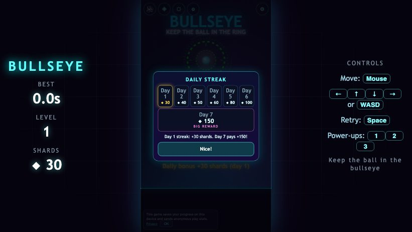
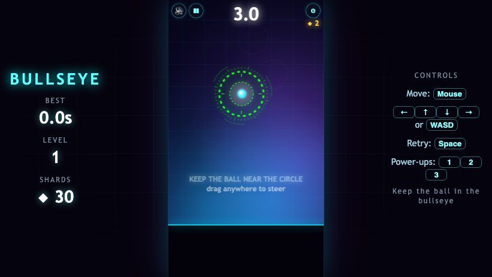
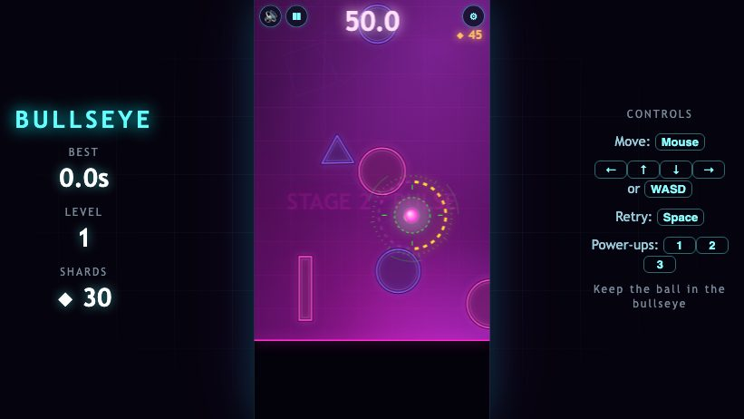
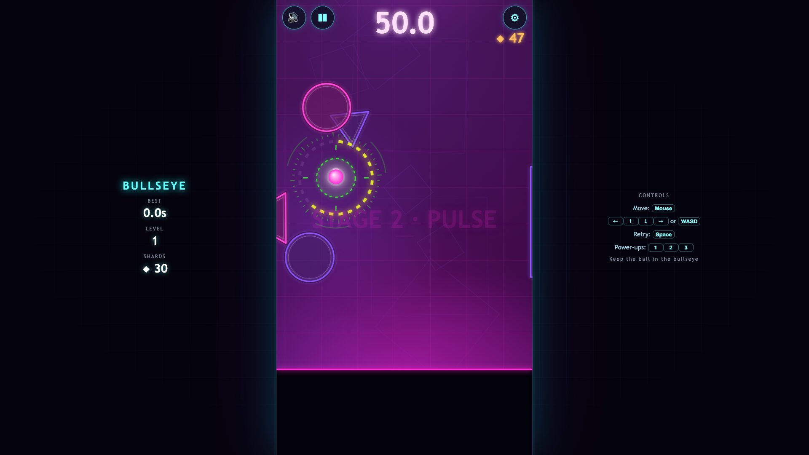
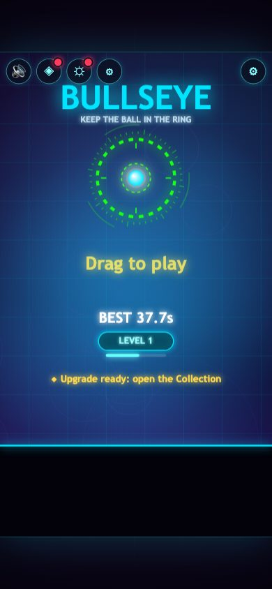
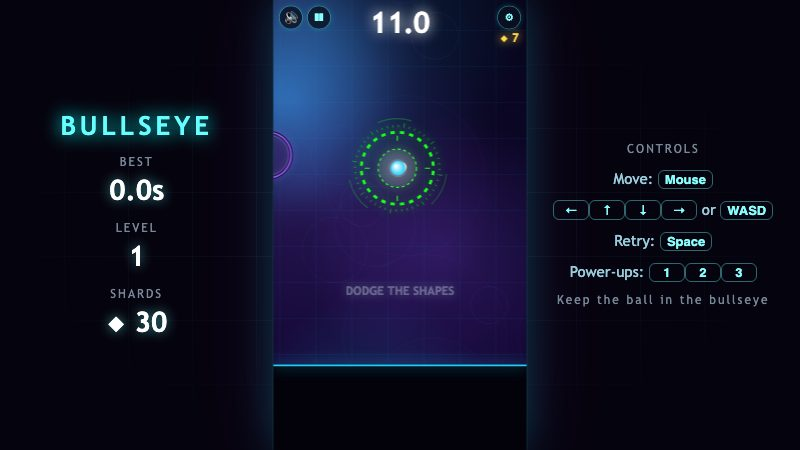
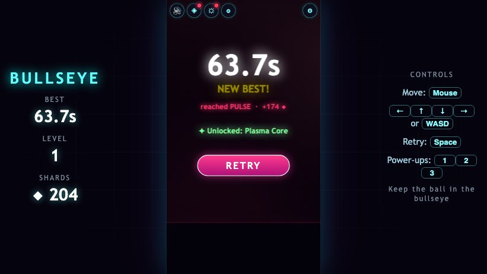
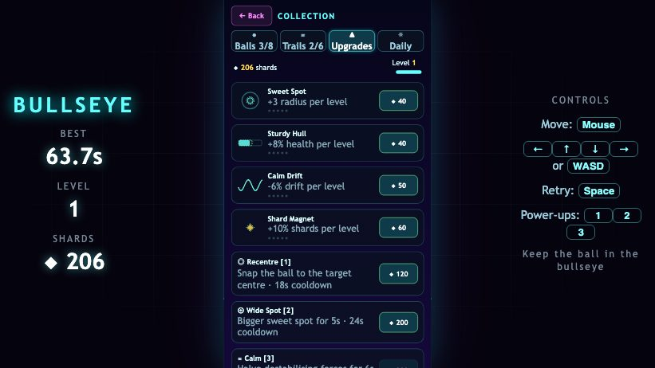
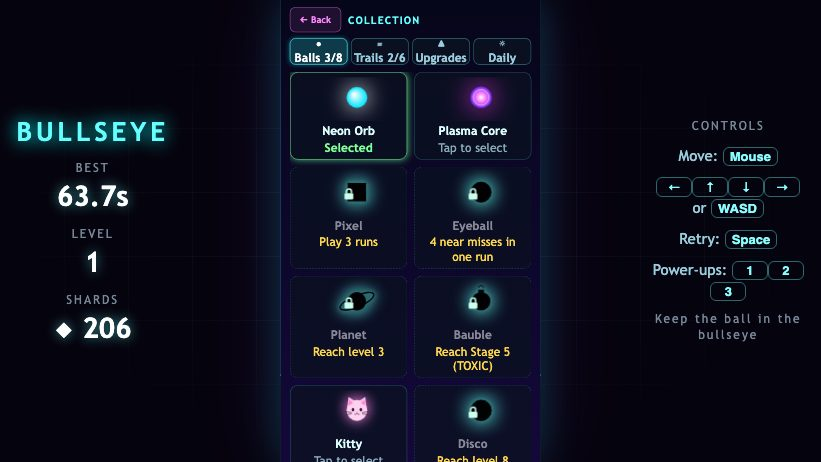

# Bullseye: play review and improvement proposal

*15 Nov 2026 · commit `fb3e636` · build 0.5.0-dev (130 KB) · Phase 1 and 2 of the launch plan. Phase 3 checklist is at the end.*

## How this was reviewed

- `node scripts/build.mjs`, `node tests/determinism.mjs` (pass at 60/120/144/165 Hz) and `node tests/bot.mjs` (numbers match launch-status §4).
- `tests/shots.mjs` (new) plays the built game in Chromium with **real input events** from cleared storage at all ten CrazyGames sizes plus a 390×844 portrait phone: mouse at six sizes, keyboard at two, touch drag at three. It steers the ring onto the ball, then lets go so the run ends, and captures title, tutorial, play, death, game over, pause, collection, upgrades, daily and settings. Raw numbers are in [play-review/report.json](play-review/report.json).
- Extra scripted checks: an idle first run, the cursor leaving the stage, and frame times under 4× and 6× CPU throttling.
- CrazyGames docs re-read today (requirements, quality guidelines, covers, Basic Launch metrics).

**Limits.** The play sessions are scripted, not a human hand, so "feel" judgements come from screenshots, timings and the code. I could not hear the audio (headless browser). Frame rates are from a headless browser without a GPU. Real devices are untested.

## What changed in the CrazyGames docs since our notes

1. **Thumbnail click-through rate becomes a fourth Basic Launch metric for games that start on or after 23 Nov 2026** (target: top 20% of the category). We will start after that date, so the covers and preview videos are now scored, not just required.
2. **Common names are not allowed** unless you own the IP ("Super Chess" is fine, "Chess" is not). "Bullseye" on its own is a common identifier and there are many Bullseye darts and archery games. The name needs a second word.
3. Mobile orientation is chosen in the submission form and enforced by the site, so we can declare **portrait on mobile** and never be shown in an 800×450 landscape phone frame.
4. Device-specific UI must not be chosen by touch detection (`ontouchstart`, `maxTouchPoints`). We choose by the last input actually used, which is fine.
5. Unchanged: sizes list, Escape and Ctrl/Cmd+W restricted, no custom fullscreen button, cover and video rules, 7–21 days and 500 plays.

## What already works well

- **The mechanic.** One gesture, readable in a second, real skill depth. Nothing here needs to change.
- **The reticle.** Ring-as-health with segments, the rotating bezel and the colour shift from green to red look distinctive and keep the eyes on the ball.
- **Speed.** Loads in about 50 ms locally, 130 KB, no errors at any size. Retry works 300 ms after death.
- **Event feedback.** Hit-stop, sparks, ring cracks, edge flashes, near-miss pop, stage wipes, milestone banners and death shatter are all present.
- **Frame pacing.** 16.7 ms median and p99 at every size, unthrottled.
- **Fair-play foundations.** Fixed 120 Hz step, seeded sim, cosmetics separate from the sim RNG.
- **Meta systems exist:** shards, levels, four upgrades, three power-ups, quests, streak, 8 balls and 6 trails.

## Findings

Severity: **S1** blocks submission or badly hurts a scored metric, **S2** clearly below studio quality, **S3** polish.

### First 10 seconds

| # | Sev | Finding | Evidence | Metric |
|---|---|---|---|---|
| F1 | S1 | **A new player's first screen is a "Daily Streak" modal**, before they have played. It blocks the title, costs a second click and explains a reward system they have no context for. |  | Conversion |
| F2 | S1 | **An idle first run dies in 5.8 s.** Moving the mouse 8 px over the title starts a run, including when the player is heading for a menu icon. If they then pause to read, the ball drifts to the edge and the run is over before the tutorial text has finished. | Scripted check | Conversion |
| F3 | S1 | **On desktop the ring freezes when the cursor leaves the stage.** At 821×462 the stage is 260 px wide in an 821 px frame, so this happens constantly; the player loses control without knowing why. | Scripted check: ring stopped at x=423 while the cursor was in the side panel | Conversion, playtime |
| F4 | S1 | **Tutorial says "drag anywhere to steer" to mouse and keyboard players**, and it is text only. CrazyGames asks for visual control prompts. |  | Conversion |
| F5 | S1 | **First-run survival is too low.** Novice bots reach 60 s on run 1 only 17% of the time (median 42 s). On run 1 the first stage change comes at 50 s, so most novices never see one. | `tests/bot.mjs` | Conversion |

### Layout and readability

| # | Sev | Finding | Evidence | Metric |
|---|---|---|---|---|
| F6 | S1 | **The game is small in every landscape frame.** The 19% footer band is empty during play, so only 58% of the frame height is playfield. At 821×462 the rail buttons are 24 px, the privacy notice is about 6 px text, and the streak card's day labels are about 7 px. |  | Requirement (readability), conversion |
| F7 | S2 | **Side panels are static and don't scale.** Same 15 px text at 821 and at 1920, where it looks lost. Left panel shows "BEST 0.0s" to a new player and does not update during a run. They read as filler, not as part of the game. |  | Quality |
| F8 | S2 | **Portrait phone wastes about a third of the screen** (letterbox bands plus the footer), and the icon rail overlaps the logo. |  | Quality on mobile |
| F9 | S2 | Mobile landscape (800×450) gives a 253 px wide stage and 24 px touch targets. Avoidable by declaring portrait on mobile (see docs change 3). |  | Requirement |

### Feel and fairness

| # | Sev | Finding | Metric |
|---|---|---|---|
| F10 | S2 | **Resume after pause is instant.** Any key or click drops the player straight back into a moving scene. A hit in the first half second after a tab switch feels unfair. | Playtime |
| F11 | S2 | **Stage banners sit on top of the action** at 60% height in the accent colour and are hard to read against the same-coloured background (see "STAGE 2 · PULSE" in the 821 play screenshot). | Quality |
| F12 | S2 | **Performance headroom is thin.** Under 4× CPU throttle at 1920×1080 the game runs at 30 fps, at 6× 20 fps. Per-frame radial gradients and `shadowBlur` on every stroke are the cost. This is a software-rendered measurement, so treat it as a warning, but a 4 GB Chromebook is the kind of device it predicts. | Requirement (ChromeOS), conversion |
| F13 | S3 | Runs feel the same after stage 2: only colour, shape outline and speed change. There is no new obstacle behaviour to discover. | Playtime |

### Game over and "one more run"

| # | Sev | Finding | Evidence | Metric |
|---|---|---|---|---|
| F14 | S1 | **The game-over screen gives no reason to play again.** After a first run the player holds 204 shards and can buy four upgrades, and the only sign is a red dot on an unlabelled icon. No next goal, no progress bar, no stage strip. Half the screen is empty. |  | Playtime, D1 |
| F15 | S2 | **Upgrades are hidden two taps away** behind a "Collection" icon, in the third tab, as a scrolling list with power-ups and a duplicate left-hand setting. Effects are described as "+3 radius per level". |  | Playtime, D1 |
| F16 | S2 | Only one unlock is announced per run; a second (Kitty, 30 s) appeared in the collection with no announcement. |  | D1 |

### Identity and polish

| # | Sev | Finding | Metric |
|---|---|---|---|
| F17 | S1 | **Name.** "Bullseye" alone breaks the common-identifier rule. | Requirement |
| F18 | S2 | **No display font.** The code asks for Orbitron, which is not bundled, so every screen falls back to Trebuchet MS (and to a different font on Android and ChromeOS). The logo is plain text. This is the main reason it reads as a prototype. | CTR, quality |
| F19 | S2 | **Icons are emoji and Unicode glyphs** (🔊 ◈ ☼ ⚙ ❚❚), which render differently per OS and have no labels. Sun for "Daily" and a diamond for "Collection" are not guessable. | Quality |
| F20 | S3 | Colour roles drift: hot pink for "reached PULSE · +174 ◆" on game over, yellow for shards elsewhere; the RETRY button is pink while every other button is teal. | Quality |
| F21 | S3 | Privacy notice sits in the empty footer in tiny text; it auto-dismisses after 20 s. | Requirement (if telemetry kept) |

### Compliance and robustness (from launch-status §5.1, re-confirmed)

| # | Sev | Finding |
|---|---|---|
| F22 | S1 | Escape closes the sheets (`11-screens.js`). Restricted key. |
| F23 | S1 | `gameplayStop` / `gameplayStart` are not sent around auto-pause, the pause button, or opening sheets mid-run. |
| F24 | S2 | The determinism test only covers idle runs of about 7 s. It never exercises input, obstacles, stages or power-ups, so it would not catch most sim regressions. |
| F25 | S2 | Audio mix is unreviewed. Needs a measured pass (levels per event, music against SFX) and a human listen. |
| F26 | — | Store assets, listing copy, device testing: not started (launch-status §5.1 items 1 and 8). |

### D1 content (launch-status §5.2)

Bots reach level 5 in ten minutes; the last unlock is at level 8; upgrades total about 1,900 shards and a decent run earns 100–180. A player can finish most of the game in two sittings. The streak pays shards only, and shards run out of things to buy.

## Proposal

Principle: no new systems. Make the existing game bigger on screen, fairer in the first minute, clearer about what to do next, and deeper in content it already knows how to show.

### Must do before submission

| ID | Change | Fixes | Metric | Effort | Risk |
|---|---|---|---|---|---|
| **P1** | **First session is play only.** No streak card until the player has finished a run (then a small non-blocking toast; the calendar stays in the Daily tab). | F1 | Conversion | S | Low |
| **P2** | **Deliberate start, forgiving opening.** Start on click, tap, Space or a movement key (one action, which CrazyGames allows), not on mouse movement. For the first 2 s of every run the ball is held at the centre while a "ready" ring closes; on run 1 no health is lost until the player first moves the ring. | F2 | Conversion | S | Low. Sim change: bot and determinism re-run |
| **P3** | **Ring follows the cursor anywhere in the frame**, clamped to the stage. | F3 | Conversion, playtime | S | Low |
| **P4** | **Tutorial matches the input and shows it.** An animated mouse, arrow-keys or finger glyph beside a three-word line, chosen by the input that started the run. Skips itself after 8 s or first obstacle. | F4 | Conversion | S | Low |
| **P5** | **First-minute protection.** On runs 1–3 the first lethal hit triggers a one-off "SHIELD" save (flash, refill to 40%, 1.5 s of safety), and run 1 damage assist rises. Tune until novice bots pass 60 s on run 1 at least 60% of the time without slowing the casual and average bots. | F5 | Conversion | M | Medium: must still feel fair, not patronising. One visible rule, announced on screen |
| **P6** | **Remove the footer band.** The stage becomes the 450×648 play area (physics untouched), so the game is 23% larger at every landscape size: 320 px wide at 821×462 instead of 260. HUD already overlays the playfield. | F6 | Readability, conversion | M | Medium: every screen is re-laid out to 648 high |
| **P7** | **Side panels become part of the game** and scale with the stage: left shows level, shards and the next goal with a progress bar; right shows controls for the input in use. Hidden values (best 0.0) are not shown. | F7 | Quality, playtime | S | Low |
| **P8** | **Portrait phone layout.** Stage fills the width, rail moves clear of the logo, safe-area insets respected, background art continues into any spare height. Declare portrait for mobile in the listing. | F8, F9 | Mobile quality | S | Low |
| **P9** | **Resume with a 3-2-1 beat** (0.9 s total) after any pause. | F10 | Playtime | S | Low |
| **P10** | **Game-over screen that sells the next run.** Time and best; stage strip (8 pips, next one named); shards counted up; one next goal with a progress bar; an **UPGRADE** button inline when something is affordable, opening straight on that upgrade; all unlocks from the run shown. RETRY stays primary and never blocked. | F14, F16 | Playtime, D1 | M | Low |
| **P11** | **Upgrades get their own screen and plain-language effects** ("Bigger sweet spot", "More health"), with a "Shop" label on the rail icon. Power-ups listed separately below. Remove the duplicated left-hand setting. | F15 | Playtime, D1 | S | Low |
| **P12** | **One type system.** Bundle one OFL display face, subset to capitals, digits and punctuation (about 10 KB, inlined as base64) for logo, numbers, stage names and buttons; system sans for body text. Draw a proper wordmark for the title screen that the covers reuse. | F18 | CTR, quality | S | Low. Check the licence allows embedding |
| **P13** | **Inline SVG icon set** (sound, shop, daily, settings, pause, back) with labels under them on the title screen; one button style; fixed colour roles (yellow = shards, cyan = UI, green = unlock, pink = danger only). | F19, F20 | Quality | S | Low |
| **P14** | **Stage banner moves to the top third on a dark plate**, 1.4 s, with the stage number as a small caption. | F11 | Quality | S | Low |
| **P15** | **Performance pass.** Pre-render the background blobs, the obstacle glow and the reticle bezel to offscreen canvases; drop `shadowBlur` from per-frame strokes; cap the canvas at DPR 2; add an automatic low-effects mode when the frame time stays above 20 ms. Target: 60 fps at 4× throttle, 1920×1080. | F12 | Requirement, conversion | M | Low: cosmetic only |
| **P16** | **Deeper ladder with what already exists.** Balls from 8 to 16 and trails from 6 to 10; level unlocks out to level 20; skill unlocks for stages 6–8, 90 s and 120 s, 8 near misses; a day-7 streak ball that cannot be bought; a "Missions" row of three tiered goals shown on the title and game-over screens (reusing the quest code) so there is always a named target. All cosmetic. | D1 gap | D1, playtime | M | Low |
| **P17** | **Compliance fixes.** Remove Escape; send `gameplayStop`/`Start` around every pause, sheet and menu; re-check `user-select` prefixes; privacy notice readable and placed over the title, or removed with telemetry. | F21–F23 | Requirement | S | Low |
| **P18** | **Stronger determinism test.** Scripted input for 90 s across stage changes and power-up use, compared at four refresh rates, plus a check that turning effects off does not change the result. | F24 | Safety net for all of the above | S | Low |
| **P19** | **Audio mix pass.** Render each SFX and the music offline, set levels against a reference (music about 8 dB under SFX), duck music on hit and death, silence on pause. You do the final listen. | F25 | Quality | S | Low |
| **P20** | **Name, covers, videos, listing.** Phase 5. Covers built from the wordmark and reticle, since CTR is now scored. | F17, F26 | CTR | M | Depends on the name |

Order: P18 first (safety net), then P6 (everything else is laid out on it), P1–P5, P9, P10–P11, P7–P8, P12–P14, P15, P16, P17, P19, then Phase 4 QA and P20.

### Nice to have (now included before submission, except N5)

| ID | Change | Metric | Effort | Risk |
|---|---|---|---|---|
| N1 | One new obstacle behaviour per later stage (pulsing circles from stage 3, paired walls with a gap from stage 5), using existing shapes | Playtime | M | Medium: balance |
| N2 | Music gains a layer per stage beyond the current four intensities | Quality | S | Low |
| N3 | Unlockable background themes (brief §6.5) as high-level rewards | D1 | M | Low |
| N4 | "So close" line on game over when within 3 s of best or of a stage | Playtime | S | Low |
| N5 | Full Launch items: SDK Data module save, ads decision, username | — | M | — |

## Decisions (Stuart, 15 Nov 2026)

| # | Decision | Answer |
|---|---|---|
| 1 | Final name | **Neon Bullseye** |
| 2 | Telemetry in the CrazyGames build | Off (recommendation, not objected to). Stays on in `dist/web`. |
| 3 | Launch path | Basic Launch, no ads (recommendation, not objected to) |
| 4 | Music | Keep procedural, with the P19 mix pass (recommendation, not objected to) |
| 5 | P2 deliberate start, P5 first-runs shield | **Yes to both** |
| 6 | Nice-to-haves | **Include N1–N4 before submission.** N5 is Full Launch work (ads are not allowed in Basic Launch) and stays out. |
| 7 | Full-frame playable area on tablet and desktop | **Investigate; include if it plays well** (item P21) |

## Phase 3 checklist (all built, 15 Nov 2026)

- [x] P18 determinism test: scripted steering, stages, power-ups, effects on/off, portrait/wide/tall fields
- [x] P6 footer removed, every screen re-laid out
- [x] P21 full-frame play field: playable, balanced with the bots, included (field 450–1152 wide)
- [x] P1 no modal on a first session
- [x] P2 click/tap/key to start; ball rides the ring until GO
- [x] P3 ring follows the cursor anywhere in the frame
- [x] P4 input-matched animated tutorial
- [x] P5 first-minute protection: second-chance shield, softer edges on runs 1–2 (novice bots: 100% portrait, 60% wide; was 17%)
- [x] P9 3-2-1 resume
- [x] P10 game-over screen with stage strip, all unlocks, next upgrade, inline upgrade button, "so close" line (N4)
- [x] P11 upgrades in plain language behind a labelled icon; power-ups listed separately
- [x] P7 side panels: removed, since the field now fills the frame; goals moved onto the title and game-over screens
- [x] P8 portrait layout: field up to 800 high, safe-area insets, rail clear of the logo
- [x] P12 own display typeface (NB Display, 4 KB) and wordmark
- [x] P13 SVG icon set with labels; fixed colour roles
- [x] P14 stage banner on a plate in the top third
- [x] P15 performance: background at 1/8 scale, no shadow blur on shapes, resolution cap, adaptive quality (60 fps at 1080p in software)
- [x] P16 16 balls, 10 trails, shard-bought and streak cosmetics, three mission ladders
- [x] N1 pulsing circles (stage 3+), gated wall pairs (stage 5+)
- [x] N2 one music layer per stage
- [x] N3 four colour themes
- [x] N4 "so close" line
- [x] P17 Escape unbound, SDK events around every pause, `user-select` prefixes, no telemetry or privacy page in the CrazyGames build
- [x] P19 audio levels measured and balanced, limiter, ducking (final listen is Stuart's)
- [x] Phase 4 QA record: [qa-record.md](qa-record.md)
- [x] P20 name, covers, videos, listing: [store/](../store/README.md), [crazygames-listing.md](crazygames-listing.md)

### Changes from the proposal

- P2: every run opens with a 0.8 s hold (not 2 s), so retry stays fast. Run 1 holds until the player moves, up to 8 s.
- P7 was dropped in favour of the full-frame field.
- Missions pay one step per ladder per run, so a strong first run does not empty the ladder.
- On wide fields, a player's first three runs get fewer shapes, and shapes stop growing after about 110 s so late stages stay readable.
- N5 (Full Launch work) is not done, as agreed.

## After the first playtest (15 Nov 2026, after submission)

**Feedback (Stuart's tester):** the player thought the job was to hold the ball in the middle of the target and missed that the ring is how you move the ball. The reticle, the dashed "sweet spot", the ring turning red with distance, "Keep the ball in the ring" and my tutorial line "Keep the ball centred" all said so.

**Change (Stuart chose the repulsor option, refined to keep the centre empty and add no arrow):**

- [x] Target redrawn as a repulsor: an empty still zone (exactly the no-force radius), ripples flowing outward from its edge, and the ripples lighting up on the ball's side in proportion to the push. Crosshair, tick bezel, arc dashes and centre dot removed.
- [x] The outer ring's colour now means health only; it no longer turns red with distance.
- [x] Leaving the still zone gives a soft tick and one brighter ripple.
- [x] Run 1 teaches the push: "Push the ball to the star", twice, with a ghost ring showing where to stand. No shapes appear until both are done (or 14 s pass).
- [x] Copy: "Push the ball. Dodge the shapes."; upgrade renamed Still Zone; power-up renamed Wide Zone.
- [x] The sweet-spot mission steps became "N s without a hit".
- [x] Covers and videos regenerated; listing description reworded.

The simulation rules are unchanged. Bot note: the bots keep the ball centred and never push to the star, so their first runs now include up to 14 s of lesson with no shapes; their first-run numbers are inflated by that and are not comparable with earlier tables.

**Second round of feedback (Stuart, same day), build 1.0.2:**

- [x] The still zone is back to its original size for everyone. New players no longer get a larger one; instead the push is 40% gentler on run 1 and 20% on run 2 (novice bots: 100% pass 60 s on run 1 on both fields; without the compensation the wide-field figure fell to 20%).
- [x] The health ring is now one thin, quiet arc that empties clockwise. It thickens and brightens briefly when health is lost and pulses red when low. The thick dashed green ring is gone.

**Uploaded:** 1.0.2, its covers, videos and reworded description were submitted to CrazyGames on 15 Nov 2026 (see `docs/handoff/launch-status.md`).
